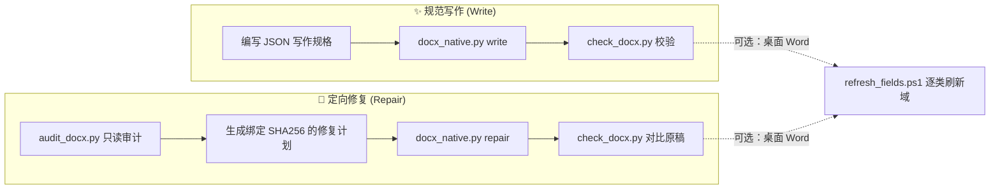

<div align="center">

# 📝 word-native-writing

**让 AI 生成真正可编辑、可更新的 Word 原生结构文档**

[](requirements.txt)
[](SKILL.md)
[](SKILL.md)

[核心特性](#-核心特性) •
[工作流程](#-工作流程) •
[快速安装](#-快速安装) •
[在 AI 中使用](#-在-ai-中使用) •
[命令行工具](#-命令行工具) •
[项目结构](#-项目结构) •
[能力边界](#-能力边界)

</div>

---

## ✨ 核心特性

AI 生成的 `.docx` 往往只是“视觉上像论文或报告”——使用 Unicode 伪上下标、手写章节与图表序号、硬编码文献标号，一旦增删内容就会全盘错乱。

**`word-native-writing`** 是一个面向 AI 编码客户端的 Word 技能与工具集，同时支持**新文档规范写作**与**已有文档定向修复**，将排版语义真正落地为 Word 原生结构。

| 常见 AI 生成痛点 | `word-native-writing` 原生方案 |
| :--- | :--- |
| 使用 `²`、`₁` 等 Unicode 伪上下标，或纯文本拼接公式 | 普通字符使用 `w:vertAlign` 真实上下标；数学公式使用原生 **OMML (`m:oMath`)** 分式、求和、上下标结构 |
| 标题手写序号、无大纲级别，无法自动生成导航与目录 | 真实 **Heading 样式**、大纲层级与多级自动编号；支持无序号标题（如参考文献）入目录 |
| 手写“图 1”“表 2”，增删图表后序号断裂 | 图、表、公式独立 **SEQ 编号源**与精确编号书签 |
| 正文硬编码“见图 1”“第 3 页”，或仅用普通超链接跳转 | 真实 **`REF` / `PAGEREF` 交叉引用域**，可随编号和页码动态刷新 |
| 文末手写 `[1]`，正文静态文本引用，前向或重复引用不一致 | 文献列表自动编号 + 稳定书签，正文全文复用 **`REF ... \n \h`**，支持前向引用与多处复用 |
| 手工拼写目录或全量暴力刷域导致格式破坏 | 真实 **TOC 目录域**，区分目录条目更新与页码更新；支持桌面 Word 逐类安全刷新 |
| 直接覆盖原稿或全量正则误伤代码、型号、数组索引 | **先只读审计、后按精确计划修复**；强制校验原稿 SHA256 与段落完整原文，拒绝覆盖原稿与歧义替换 |

> [!TIP]
> **文档导航**：技能触发入口见 [`SKILL.md`](SKILL.md)，详细规则请参阅 [📘 规范写作指南](references/writing.md) 与 [🛠️ 文档修复指南](references/repair.md)。

---

## 🔄 工作流程



---

## 📦 快速安装

### 1. 安装 Skill 到客户端目录

将本仓库克隆至 AI 客户端的 Skill 发现目录，并保持目录名为 `word-native-writing`。以 Windows 上使用 `.agents\skills` 的客户端为例：

```powershell
git clone https://github.com/Abo-Fat/word-native-writing.git "$env:USERPROFILE\.agents\skills\word-native-writing"
```

> [!NOTE]
> - 目标目录必须尚不存在；已安装时请勿重复克隆或覆盖本地修改。
> - 其他客户端请按其实际 Skill 目录位置安装。若当前会话未自动发现新技能，请重新打开会话。
> - 本技能与通用 `docx` Skill 互补，不会替换已有的通用 `docx` Skill。

### 2. 安装 Python 依赖

环境要求 **Python 3.9+**。只读审计、结构检查及基础解包/打包仅依赖 Python 标准库；原生写作、计划修复和 Flat OPC 打包需要 `lxml`。缺失依赖时在仓库根目录执行：

```powershell
python -m pip install -r .\requirements.txt
```

---

## 💬 在 AI 中使用

安装后可直接在对话中点名调用 `word-native-writing`：

**场景一：撰写新报告或论文**
> 使用 `word-native-writing` 撰写 Word 报告，正确处理上下标、标题编号、图表题注和文献交叉引用。

**场景二：审计并修复已有 DOCX**
> 使用 `word-native-writing` 审计并修复这份 DOCX，保留原稿和技术内容，将静态编号及引用转换为可更新的 Word 原生结构。

> [!IMPORTANT]
> AI 必须先阅读对应指南，再根据当前文档的实际内容生成写作规格或修复计划；`assets/` 中的示例文件仅作结构演示，**不可原样套用到任意文档**。

---

## 🔧 命令行工具

以下命令均假定当前工作目录为本仓库根目录。

### 1. 规范写作 (`write`)

根据 UTF-8 JSON 写作规格生成带原生结构的 `.docx` 并执行结构检查：

```powershell
python -X utf8 .\scripts\docx_native.py write .\assets\writing-example.json "D:\work\Word结构示例.docx"
python -X utf8 .\scripts\check_docx.py "D:\work\Word结构示例.docx"
```

- 支持富文本段落、真实上下标、多级标题、图表公式题注、文献列表、交叉引用、原生 OMML 公式、自动目录及简单文字表格。
- 示例文件中的文献为明确标注的占位信息，正式交付时须替换为真实文献。

### 2. 定向修复 (`audit` → `repair` → `check`)

先对原稿做只读审计，再依据绑定原稿哈希与段落原文的修复计划输出新文件，最后与原稿对比校验：

```powershell
# 1. 只读审计（如有模板可附加 --template "D:\work\模板.docx"）
python -X utf8 .\scripts\audit_docx.py "D:\work\原稿.docx" --output "D:\work\audit.json"

# 2. 参考审计结果与 assets\repair-plan.example.json 编写本次专属的 repair-plan.json

# 3. 执行非破坏性修复，输出到新路径
python -X utf8 .\scripts\docx_native.py repair "D:\work\原稿.docx" "D:\work\repair-plan.json" "D:\work\修复暂存.docx"

# 4. 校验修复结果并与原稿比对
python -X utf8 .\scripts\check_docx.py "D:\work\修复暂存.docx" --source "D:\work\原稿.docx"
```

> [!WARNING]
> 修复计划必须严格绑定本次审计产出的 **原稿 SHA256、段落索引及完整原文**。工具不会自动猜测科学符号、引用对象或公式含义。

### 3. 可选：桌面 Word 域刷新 (`refresh_fields.ps1`)

当 Windows 环境已安装桌面版 Word 且允许 Word 自动化时，可按类别刷新编号、交叉引用与页码：

```powershell
powershell -NoProfile -File .\scripts\refresh_fields.ps1 -InputPath "D:\work\修复暂存.docx" -OutputPath "D:\work\修复完成.docx"
```

- 逐类刷新已有编号、`REF` 与页码，并保留 Flat OPC 恢复状态。
- **不会补建缺失引用，也不会重建目录条目**；若新增或变更了目录结构，需在 Word 中定向执行“更新整个目录”。

---

## 📂 项目结构

```text
word-native-writing/
├── SKILL.md                        # 技能触发条件、核心规范与执行入口
├── requirements.txt                # Python 依赖声明 (lxml>=4.9)
├── references/
│   ├── writing.md                  # 新文档规范写作详细指南
│   └── repair.md                   # 已有文档审计与修复详细指南
├── assets/
│   ├── writing-example.json        # 规范写作 JSON 输入规格示例
│   └── repair-plan.example.json    # 定向修复计划 JSON 示例
└── scripts/
    ├── docx_native.py              # 原生写作 (write) 与精确计划修复 (repair) CLI 入口
    ├── word_native.py              # 上下标、OMML 公式、编号、书签及域底层构造函数
    ├── audit_docx.py               # DOCX 只读审计工具
    ├── check_docx.py               # 域闭合、书签配对、引用目标与源内容辅助比对检查器
    ├── docx_package.py             # 标准库 DOCX 解包/打包工具（非完整 XSD 校验器）
    ├── refresh_fields.ps1          # Windows 桌面 Word 逐类域刷新脚本
    ├── package_word_state.py       # Word 状态导出与 Flat OPC 打包工具
    └── office_skill_bridge.py      # 可选桥接本机已有通用 docx Skill 的校验器
```

---

## 🚧 能力边界

- **定位清晰**：本工具不是任意复杂文档的一键全自动修复器，也不是完整排版引擎。涉及复杂模板、图片排版、分节符、附录混排及修订模式时，应配合通用 DOCX 工具精确处理；含复杂内联结构的目标段落不会被粗暴展平成纯文本以强行修复。
- **校验范围**：`check_docx.py` 的结构检查与 XSD 校验不能替代公式数学语义审查、Word 字段实际计算或逐页视觉复核。未实际运行的验证步骤必须在交付时明确标注“未验证”；无桌面 Word 环境时仍可生成合法原生结构，但目录、页码和重排后的显示缓存需后续在 Word 中重新计算。
- **隐私与洁净仓库**：本仓库不包含任何用户原始报告、正文审计数据、带硬编码路径的历史案例脚本或第三方 DOCX Skill 源码。请勿将个人原稿、审计结果或含敏感内容的修复计划提交到公开仓库。

